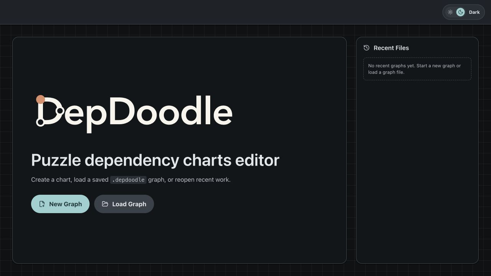
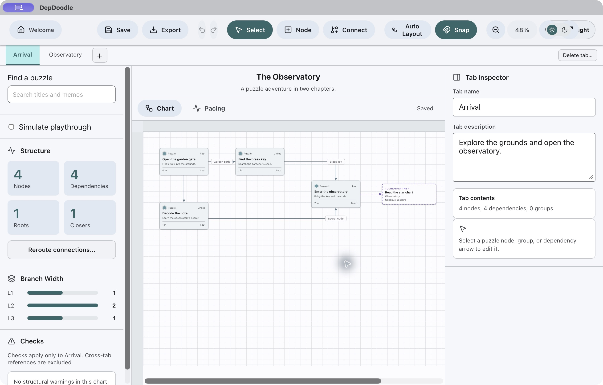
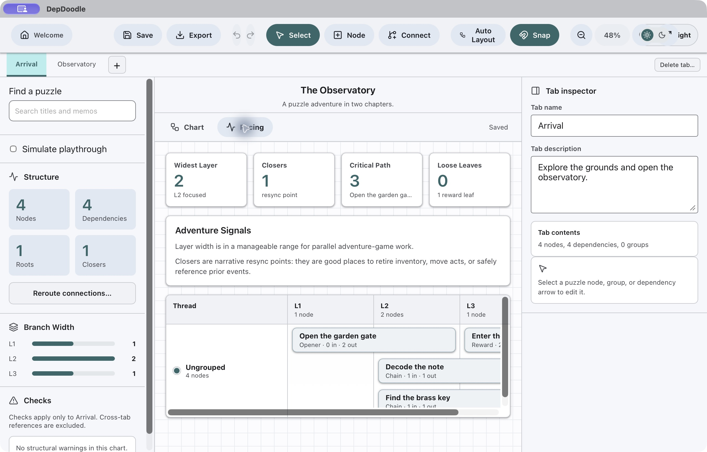

# DepDoodle

<p align="center">
  <picture>
    <source media="(prefers-color-scheme: dark)" srcset="public/depdoodle-logo-dark.svg" />
    <source media="(prefers-color-scheme: light)" srcset="public/depdoodle-logo.svg" />
    
  </picture>
</p>

DepDoodle is a Tauri desktop editor for puzzle dependency charts. It is built
for adventure-game puzzle design: showing what must be solved before what,
where branches open, where they collapse, what the player can work on at once,
and which narrative assumptions are safe.

The app aims for an OmniGraffle-like charting surface, but with puzzle-chart
semantics built in: dependency tokens, puzzle/gate/reward nodes, structural
checks, visible groups, D2/TALA routing, and a pacing view generated
from the dependency graph.

[Download the latest release](https://github.com/Fulviuus/depdoodle/releases/latest)
for Windows, macOS, or Linux.

## New in 0.2.0

- D2/TALA replaces Graphviz for connection routing and confirmed automatic layout.
  Connections update as boxes move; existing box positions stay under your control.
- Checks can be selected together, with glowing matches and the rest of the chart
  faded to 20% opacity.
- Interactive playthrough adds Solve/Undo controls, completion crosses, and
  animated connections to the next available puzzles.
- AND/OR prerequisites, narrative checks, search, and prerequisite/unlock focus
  help inspect the structure of larger charts.
- More reliable saving, recovery, recent files, and closing protect editing work.
- Refreshed logos and application icons support light and dark themes.

## Screenshots

### Welcome



### Chart Editor



### Pacing View



The screenshots use a small sample chart created only for documentation. The
sample graph is not bundled as an app project.

## What It Edits

A puzzle dependency chart is a directed graph:

- A node is a puzzle, gate, reward, action, or meaningful task.
- An edge is a dependency: if `A -> B`, then `B` requires `A`.
- An edge label is the dependency token: an item, access, fact, state change, or
  permission.
- Roots are immediately available puzzle work.
- Leaves are endpoints, rewards, optional loose ends, or suspicious dangling
  puzzle work.
- Bottlenecks or closers are places where multiple branches collapse.
- A healthy adventure chart often expands into parallel work and contracts into
  milestones.

The longer design memo lives in
[PUZZLE_DEPENDENCY_CHART.md](PUZZLE_DEPENDENCY_CHART.md).

## Core Features

- **Welcome screen**: create a new graph, load a `.depdoodle` file, or reopen a
  recent graph.
- **Visible file metadata**: edit the chart name and description from the
  inspector when nothing is selected.
- **Puzzle nodes**: create and edit puzzle, gate, and reward nodes.
- **Node details**: title, memo, optional difficulty, kind, color, incoming
  count, outgoing count, role, prerequisites, unlocks, and safe narrative
  context.
- **Dependency arrows**: connect nodes with directed arrows and label each edge
  with a dependency token.
- **Token types**: item, access, fact, state, and permission.
- **Groups**: create visible groups from selected nodes, name them, color them,
  drag them, hide/show them, ungroup them, or delete their contents with
  confirmation.
- **Pacing tab**: a Gantt-like availability view generated from dependency
  layers, with groups as lanes.
- **Structural checks**: cycles, missing roots, non-reward leaves, over-wide
  layers, missing closers, and routing errors. Toggle multiple checks to glow
  their matching elements and fade the rest to 20% opacity; deselect them to
  restore the normal chart.
- **Branch width chart**: quick view of how many nodes sit in each dependency
  layer.
- **Auto Layout**: D2/TALA automatic box layout, with explicit
  confirmation before moving nodes and replacing connector routes and labels.
- **Routing**: automatic D2/TALA connection routing on load and after
  graph edits, including live previews while dragging boxes. The preview and
  release use the same router; manual connector and label overrides are preserved.
  Routing keeps every node at its saved position. Inspecting checks or switching views does not
  rearrange boxes or recalculate connection routes.
- **Zoom controls**: zoom in, zoom out, reset, and fit chart to view.
- **Snap to grid**: optional grid snapping for node and group movement.
- **Multiple selection**: box-select or modifier-select nodes, then drag or
  group them.
- **Undo/redo**: multi-step history for graph edits.
- **Search and checks**: jump to and highlight matching puzzles without hiding
  the rest of the chart or changing its zoom and layout.
- **Explicit focus**: use Focus prerequisites or Focus unlocks to isolate a
  subgraph. A visible banner identifies the focused view and restores the entire
  graph with one click.
- **Playthrough simulation**: solve puzzles directly on the chart. Completed
  puzzles get an X, moving dashes lead to accessible next steps, and locked
  puzzles and connections fade to 20% opacity. Undo completion or reset the
  playthrough without editing the chart.
- **Prerequisite rules**: require all incoming dependencies (AND, the default),
  or any incoming dependency (OR) for alternative solutions.
- **Narrative references**: tag events assumed by a puzzle's writing. Checks flag
  missing references and events that are not guaranteed by its prerequisites.
- **Recovery drafts**: edits are saved locally for recovery, with explicit
  Save/Discard/Cancel prompts before leaving an edited graph.
- **Themes**: light and dark mode.
- **Save**: writes a `.depdoodle` project file.
- **Export**: PNG, JPG, PDF, and SVG.

## Main Views

### Welcome

The welcome screen is the project entry point. It shows the product logo,
creates new graphs, loads existing `.depdoodle` files, and lists recent files.
Recent items can be removed individually or cleared as a group.

Recent entries are stored locally. In the desktop app, reopening a recent file
reads its current contents from disk. If access has expired or the file moved,
locate the file again. Browser-only recents retain a snapshot because browsers do
not provide persistent filesystem access.

Save important work as a `.depdoodle` file. Unsaved edits also create a local
recovery draft; after an interrupted session, choose **Recover unsaved draft** on
the welcome screen. A successful save or explicit discard clears that draft.
Recovery depends on local storage being available and is not a backup of the
project file.

### Chart

The Chart tab is the editable dependency canvas. It contains:

- left analysis sidebar
- central graph canvas
- right inspector
- toolbar for save, export, undo, redo, tools, layout, snap, zoom, fit, and
  theme

Connection routing runs automatically, including for older files that do not
store bend points. While dragging, connections follow the boxes and D2 refines
their routes in the background; releasing keeps the latest route for the final
position. **Auto Layout** is the only operation that
rearranges boxes, and it always requires explicit confirmation. Saved manual
connection and label overrides take precedence over automatic routing.

Use **Node** to place puzzle nodes. Use **Connect** to click one node and then
another, creating a dependency. Use **Select** to move nodes, select groups, drag
routes, or edit labels.

### Pacing

The Pacing tab turns the dependency graph into an availability timeline:

- columns are topological dependency layers
- lanes are visible groups
- bars show when puzzle work becomes available and how far it influences later
  work
- closers, critical path length, loose leaves, and broad layers are summarized

Puzzles with an OR prerequisite use their earliest alternative dependency layer.
Their safe narrative context contains only ancestors shared by every alternative.
Cycles remain visible as structural warnings; the critical path is suppressed
until the cycle is resolved.

This is deliberately not a calendar Gantt chart. It does not guess real time or
task duration. It is a puzzle-availability chart: useful for spotting linear
stretches, over-broad layers, act gates, and pacing pressure.

### Checks and Playthrough

Click a check in the analysis sidebar to highlight its nodes and connections.
Click additional checks to combine their highlights, or click a selected check
again to remove it. Checks do not move boxes or edit the project.

Enable **Simulate playthrough** in the sidebar, then use **Solve** on an available
puzzle. Completed puzzles show an X, and moving dashes point to newly available
work. Inaccessible elements are 80% transparent. Use **Undo** to reverse a
completion or **Reset playthrough** to start again. Undoing a prerequisite also
clears completions that are no longer reachable.

Simulation follows each puzzle's AND/OR prerequisite rule and is also visible
in the Pacing tab. It does not change the saved project. Disabling simulation
restores the normal chart; enabling it again resumes the current playthrough.

## Inspector Behavior

The inspector edits whatever is selected:

- **Nothing selected**: chart name, chart description, file name, and contents.
- **One node selected**: node semantics and relationships.
- **Multiple nodes selected**: selection summary, create group, or delete nodes.
- **Group selected**: group name, color, visibility, ungroup, or delete group
  contents.
- **Edge selected**: dependency token label, token type, route reset, label
  reset, or delete edge.

This is intentional: semantic data should be visible and editable. The app
should not rely on hidden chart meaning.

## File Format

DepDoodle projects use the `.depdoodle` extension. The contents are versioned
JSON so they are easy to inspect, diff, recover, and transform.

Current format:

```json
{
  "format": "depdoodle.graph",
  "version": 1,
  "title": "Basement Door Puzzle Study",
  "description": "Optional visible project notes.",
  "world": {
    "width": 1500,
    "height": 900
  },
  "nodes": [],
  "edges": [],
  "groups": []
}
```

### Node Fields

Each node stores:

- `id`
- `title`
- `note`
- `kind`: `puzzle`, `gate`, or `reward`
- `color`
- optional `difficulty`
- `prerequisiteMode`: `all` (default) or `any`
- `narrativeReferences`: IDs of events assumed by the node's writing
- `x`, `y`, `width`, `height`

### Edge Fields

Each dependency edge stores:

- `id`
- `from`
- `to`
- `label`
- `tokenType`: `item`, `access`, `fact`, `state`, or `permission`
- optional `manualRoute`: saved connector waypoints, whether drawn by hand or
  accepted from an explicitly confirmed routing action
- optional `manualLabelPosition`: saved label position along the connector

### Group Fields

Each visible group stores:

- `id`
- `name`
- `color`
- `nodeIds`
- `hidden`

Groups are the only semantic lane/thread system used by the Pacing tab. If a
node is not in a group, it appears in an **Ungrouped** lane.

### Legacy Data

Older project files may contain a hidden node field called `act`. The current
app does not use hidden `act` data. On load, legacy `act` values are converted
into visible groups. A legacy `Beginning / Ending` act is split into separate
`Beginning` and `Ending` groups.

When saved again, the project uses visible groups and no hidden `act` fields.

## Export

DepDoodle can export the visible chart as:

- PNG
- JPG
- PDF
- SVG

Raster exports use a higher internal scale for better quality. SVG export is the
best choice when the chart needs to stay editable or scale cleanly in other
tools.

## Architecture

DepDoodle is intentionally small:

- **Tauri 2** for the desktop shell.
- **Vite** for frontend development.
- **TypeScript** for app logic.
- **Vanilla DOM/CSS** for the UI.
- **D2/TALA** for graph layout and routing: a bundled native helper on desktop,
  and `@d2lang/d2` in a background worker for the browser frontend.
- **Lucide** for toolbar and UI icons.

Important paths:

- [src/layout-engine.ts](src/layout-engine.ts): D2/TALA adapter with fixed-position routing.
- [src-d2](src-d2): bundled native D2 helper.
- [scripts/build-d2.mjs](scripts/build-d2.mjs): platform-specific helper build.
- [src/main.ts](src/main.ts): app state, graph editing, rendering, routing,
  import/export, analysis, and inspector logic.
- [src/styles.css](src/styles.css): Material-style UI, canvas, nodes, groups,
  edges, welcome screen, and pacing view.
- [src/semantics.ts](src/semantics.ts): prerequisite rules, simulation, cycles,
  and guaranteed narrative context.
- [src/spatial-index.ts](src/spatial-index.ts): route-label collision queries.
- [src-tauri](src-tauri): Tauri desktop configuration and Rust shell.
- [public/depdoodle-logo.svg](public/depdoodle-logo.svg): vector product logo,
  with a [dark version](public/depdoodle-logo-dark.svg),
  [standalone mark](public/depdoodle-mark.svg), and
  [app icon source](public/depdoodle-icon.svg).
- [docs/screenshots](docs/screenshots): README screenshots.
- [PUZZLE_DEPENDENCY_CHART.md](PUZZLE_DEPENDENCY_CHART.md): puzzle dependency
  chart design memo.

## Releases

Release builds are published on
[GitHub Releases](https://github.com/Fulviuus/depdoodle/releases) for Windows,
macOS (Apple Silicon and Intel), and Linux.

Download the installer or package for your platform from the release assets.
Packaged builds include the D2 engine; no additional layout software is needed.

The macOS builds are ad-hoc signed but not notarized. On first launch, macOS may
block the app until it is allowed from **System Settings > Privacy & Security**.

## Development

Desktop builds require Node.js, the Tauri/Rust toolchain, and Go 1.27+ for the
bundled D2 helper. Users of packaged builds do not need Go or D2 installed.
The helper is built automatically by `tauri dev` and `tauri build`.

Install dependencies:

```bash
npm ci
```

Run the desktop app:

```bash
npm run tauri dev
```

Run the browser-only frontend:

```bash
npm run dev
```

Build the frontend:

```bash
npm run build
```

Run the frontend regression suite (Node.js 20, 22, or 24+):

```bash
npm test
```

Test the native D2 helper:

```bash
cd src-d2
go test ./...
```

D2 0.9.0 is bundled under [MPL-2.0](https://github.com/d2lang/d2/blob/v0.9.0/LICENSE.txt).
Its license and third-party notices are included in desktop builds; source is
available at [d2lang/d2](https://github.com/d2lang/d2/tree/v0.9.0).
The native helper avoids a WebKit WebAssembly worker stack limit. The browser
frontend uses the WASM package and requires a compatible browser.

The tests cover real D2 routing, fixed box positions, drag previews, check
highlighting, cycles, unsaved changes, recovery, native save/open behavior,
exports, simulation, prerequisite rules, narrative references, and focus views.

Create a production Tauri build:

```bash
npm run tauri build
```

## Design Principles

- Prefer visible semantics over hidden metadata.
- Keep graph data recoverable and human-readable.
- Use groups for lanes, acts, characters, locations, chapters, or puzzle
  threads.
- Use D2/TALA for confirmed box layout and automatic connection routing; lock
  every box during connection-only routing.
- Keep manual layout overrides explicit and saved.
- Treat the dependency chart as design structure, not a walkthrough.
- Use analysis to reveal risks, not to dictate one correct design.

## Current Limitations

- Recovery drafts are local; use Save to update the `.depdoodle` project file.
- The app does not currently import GraphML directly from the UI.
- Pacing bars are generated from dependency layers, not real time estimates.
- Narrative checking validates explicit event references; it does not infer
  references from the prose of a memo.
- The file format is versioned but still early.

## License

DepDoodle is licensed under the GNU General Public License v3.0. See
[LICENSE](LICENSE).

## Reference Material

The project is based on the puzzle dependency chart workflow described by Ron
Gilbert and expanded through graph-analysis language by Joshua Weinberg. See the
local memo for project-specific notes:

[PUZZLE_DEPENDENCY_CHART.md](PUZZLE_DEPENDENCY_CHART.md)
